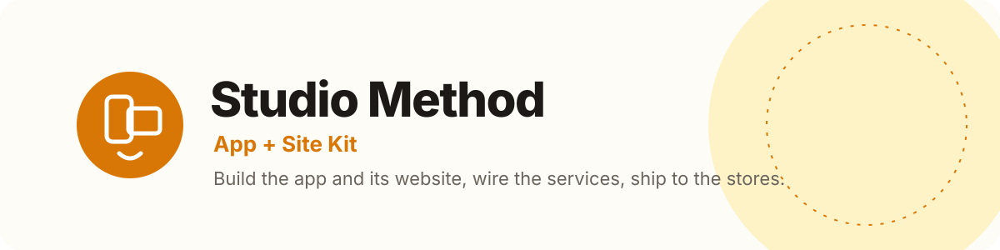
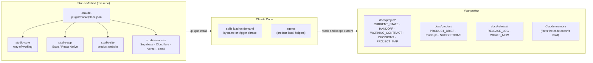
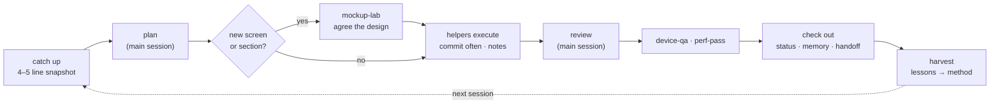
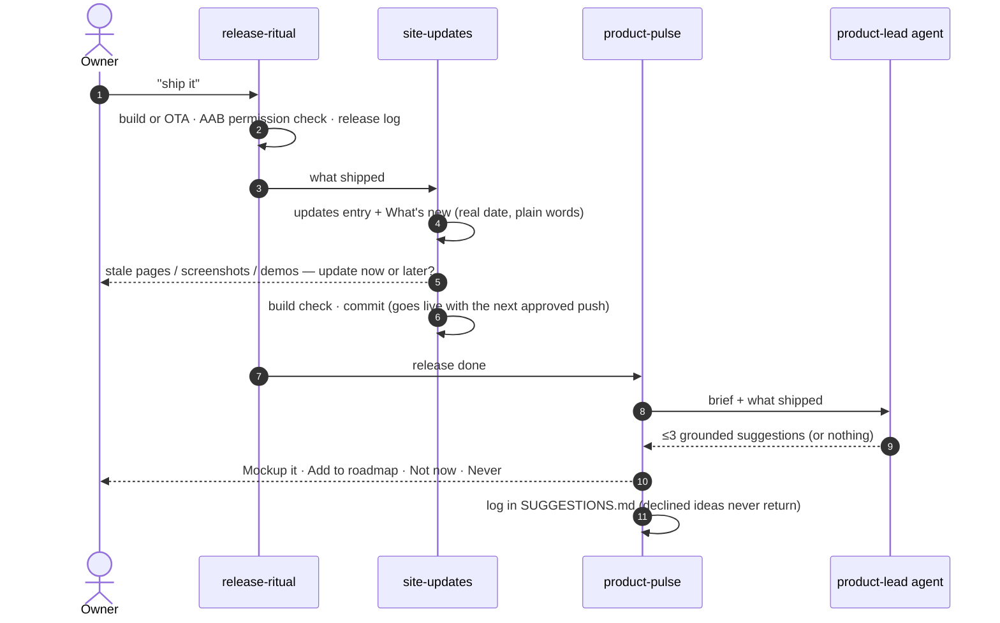
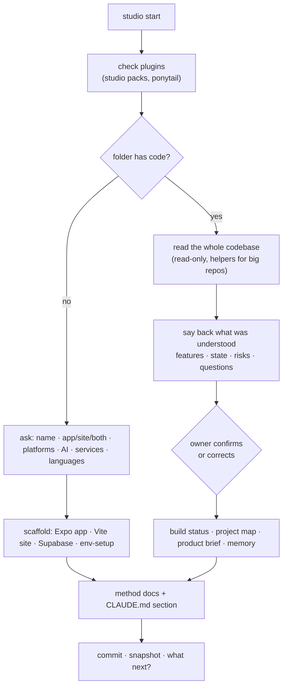
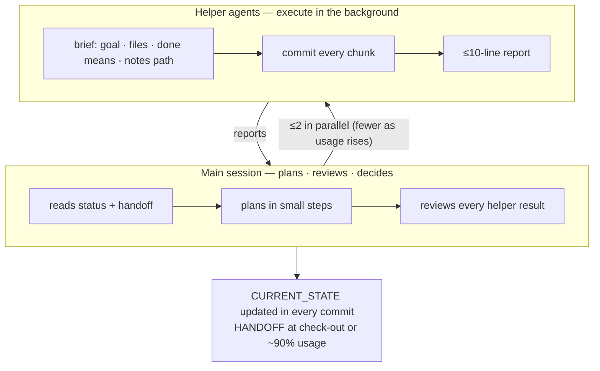

<p align="center">
  
</p>

<p align="center">
  <b>A Claude Code plugin marketplace for building a React Native app <i>and</i> its website — with a working style that never loses context.</b>
</p>

<p align="center">
  
  
  
  
  
</p>

---

Studio Method turns Claude Code into a small product studio. It brings **how to work** (status and handoff docs,
helper agents, check-ins, catch-up and check-out), **how to build** (Expo app, marketing website, Supabase,
Cloudflare, Vercel, email) and **how to ship** (device QA, Play releases, OTA updates, store listings, website
updates) together as skills an AI coding agent loads when they're needed.

It was distilled from shipping a real product — an Expo + Supabase app on Google Play and its Vite + React website
on Vercel — and every rule in it exists because something went wrong once. Fork it, use it, make it yours.

## Contents
- [What you can do with it](#what-you-can-do-with-it)
- [How it works](#how-it-works)
- [The packs](#the-packs)
- [Install](#install)
- [Quick start](#quick-start)
- [The words you'll use](#the-words-youll-use)
- [The working style](#the-working-style)
- [The stack it knows](#the-stack-it-knows)
- [What a project looks like](#what-a-project-looks-like)
- [Make it yours](#make-it-yours)
- [Roadmap](#roadmap)
- [FAQ](#faq)
- [Contributing](#contributing) · [License](#license)

## What you can do with it

| You want to… | Studio Method… |
|---|---|
| **Start from nothing** | asks what you're building (app, website or both; AI or not; which services; languages), scaffolds it with current tools, and walks you through every environment variable and console |
| **Bring an existing repo in** | reads the whole codebase first, tells you what it understood (features and their state, risks, open questions), and after you confirm builds the project's status doc, a codebase map and its own memory |
| **Design before code** | builds clickable phone or website mockups with sample data, with a toggle for every open decision; the agreed mockup becomes the spec |
| **Build with helpers** | the main session plans and reviews; helper agents execute in the background, commit often and keep short notes |
| **Test on real devices** | runs a QA protocol on an emulator or a USB phone: RAM checks, demo accounts on a local backend, focus checks before every input, keyboard-open tests |
| **Fix "it feels slow"** | measures first, splits the cost, fixes the real cause, measures again and reports a before/after table |
| **Ship the app** | Play builds and OTA updates with an AAB permission check, a release log, plain-words What's new and store notes |
| **Look premium in the store** | renders designed screenshots (light and dark) and a feature graphic from real captures, plus paste-ready listing copy, on one review page with downloads |
| **Keep the website true** | after every release, writes the updates entry, finds stale pages, screenshots and demos, and ships with your next approved push |
| **Know what to build next** | a senior product-lead agent offers at most three grounded suggestions after a release — and remembers what you declined |
| **Never lose context** | `check out` writes the handoff; `catch up` resumes from it in seconds, in a fresh session |
| **Grow the method** | `harvest` carries lessons from any project back into the method; `forge` turns a working flow into a new skill |

## How it works

### The pieces


### A session


### A release


### Starting a project


## The packs

Install only what a project needs. Every skill works in any project; WowTodo appears only as labelled examples.

### `studio-core` — the way of working (every project)
| Skill / agent | What it does |
|---|---|
| **studio-start** | New project from scratch, or adopt an existing repo (reads it all, says back, builds memory) |
| **working-contract** | The standing contract: three project docs, Opus plans / helpers execute, check-ins, usage limits, plain output |
| **playbook** | ~35 hard rules (each with its Why and How to apply) and the glossary of shared words |
| **catch-up** | Snapshot of where things stand, then continue / start new / close loose ends |
| **check-out** | Close a session cleanly: take stock, update status and memory, write the handoff, owner to-dos, starter line |
| **mockup-lab** | Clickable phone or website mockups with sample data and decision toggles, iterated until agreed |
| **product-pulse** + `product-lead` agent | A senior PM's ≤3 grounded suggestions after releases; logged, never repeated once declined |
| **harvest** | Offer this session's lessons to the method; you approve each one |
| **forge** | Build or improve a skill in the method repo: research, write, validate, version, commit |
| **teach** | Learn the concept behind what was just done, pitched at your level |
| **optimize-repo** | Reclaim disk space by safely removing regenerable caches, every 15 days |
| **github-to-gitlab** | Move a repo to GitLab safely: audit, backups, push by refspec, verify by hash |

### `studio-app` — React Native + Expo
| Skill | What it does |
|---|---|
| **device-qa** | Emulator or USB-phone QA: RAM check, emulator settings, local backend swap, demo accounts, `adb reverse`, focus and keyboard checks |
| **perf-pass** | Measure-first performance work with JS/UI-thread markers and a before/after table |
| **release-ritual** | Play build (EAS quota, versionCode, AAB permission check) or OTA, release log, console review, then site updates and a product pulse |
| **store-listing-kit** | Designed store screenshots (light + dark), feature graphic and listing copy, rendered from real captures, on one review page |

### `studio-site` — the product website
| Skill | What it does |
|---|---|
| **site-builder** | Story-led marketing site (Vite, React, Tailwind, GSAP): chapters, live demos from mockups, updates page, waitlist, SEO, Vercel |
| **site-updates** | After every release or deploy: updates entry, What's new, stale pages and screenshots found and refreshed, optional announcement |

### `studio-services` — the services behind it
| Skill | What it does |
|---|---|
| **stack-guide** | How Supabase, Cloudflare R2 and DNS, Vercel, Resend + Zoho, Google sign-in, EAS and AI providers fit, with the gotchas |
| **env-setup** | Every env var the chosen services need, where each comes from, `.env.example`, local/cloud swap — secrets never in chat |
| **email-setup** | Email on your own domain: receive at contact@/support@, reply from them, send `noreply@` through Resend, with deliverability tests |

## Install

### Requirements
- [Claude Code](https://docs.claude.com/en/docs/claude-code) with plugin support (`/plugin` command).
- Git, Node.js LTS. For apps: Android SDK (emulator or USB debugging) and an Expo/EAS account. For sites: a Vercel
  account. Services as you choose them (Supabase, Cloudflare, Resend…); `env-setup` walks you through each.

### 1. Add the marketplace
In Claude Code, any project:
```
/plugin marketplace add aavritidesignstudio/studio-method
```
That's the GitHub mirror. The same marketplace from GitLab, where it's developed:
```
/plugin marketplace add https://gitlab.com/aavritidesignstudio/studio-method.git
```
A local clone works too: `/plugin marketplace add ./studio-method`.

### 2. Install the packs you need
```
/plugin install studio-core@studio-method
/plugin install studio-app@studio-method        # mobile app (Expo / React Native)
/plugin install studio-site@studio-method       # product website
/plugin install studio-services@studio-method   # Supabase, Cloudflare, Vercel, email
```
Restart Claude Code. Check with `/plugin` → Installed.

### 3. Recommended: ponytail
[ponytail](https://github.com/DietrichGebert/ponytail) keeps generated code minimal (YAGNI, standard library first,
shortest working diff). `studio-start` checks for it:
```
/plugin marketplace add DietrichGebert/ponytail
/plugin install ponytail@ponytail
```

### Update and remove
```
/plugin marketplace update studio-method     # fetch the latest method
/plugin                                       # → Installed → update or uninstall a pack
```

## Quick start

**New project:** make an empty folder, open Claude Code in it, say **`studio start`**, and answer a few questions.

**Existing project:** open Claude Code in the repo and paste [`ADOPT.md`](ADOPT.md) (or say **`studio start`**). It
reads everything first and tells you what it understood before changing anything.

**Every session after that:** start with **`catch up`**, end with **`check out`**.

## The words you'll use

| Say | What happens |
|---|---|
| **studio start** | Set up a new project, or bring an existing repo into the method |
| **catch up** | 4–5 line snapshot from the status and handoff docs, then continue / start new / close loose ends |
| **check out** | Close the session: status, memory, handoff, owner to-dos, commit, a starter line for next time |
| **mockup** | A clickable mockup to agree on before any code |
| **update the website** | After a deploy: updates entry, What's new, stale pages and screenshots refreshed |
| **product pulse** | A senior PM's take: at most three grounded ideas (also runs after releases) |
| **teach** | Learn the concept behind what was just done, at your level |
| **optimize repo** | Free disk space by clearing caches safely |
| **harvest** | Offer today's lessons to the method (you approve each one) |
| **forge** | Build or improve a skill in the method |
| **go ahead** | Permission for exactly the steps just listed — nothing more |

The full glossary lives in the `playbook` skill.

## The working style



- **Three docs** per project: status (`CURRENT_STATE.md`), handoff (`HANDOFF.md`), contract (`WORKING_CONTRACT.md`).
- **Plans in the main session, execution in helpers.** Helpers touch non-overlapping files, commit often, keep
  15-line notes, and never edit the status doc.
- **Usage-aware:** below 75 % up to two helpers; 75–85 % one; 85–90 % wrap up; 90 %+ write the handoff.
- **Plain output:** short sentences, no recaps of what you can see, file names only when you need them to act.
- **Outward actions need a yes:** pushes, deploys, store submissions, emails. "Go ahead" covers exactly what was
  listed.

A taste of the playbook's hard rules:
> **Real dates only** — run `date` before writing any date; a future-dated release note costs trust.
> **The keyboard never hides the input** — test every input with the keyboard open, every QA pass.
> **Check the built AAB's permissions** after any native or plugin change — one flag can strip the microphone app-wide.
> **Never test as the owner** — demo accounts on a local backend; on a real phone, check app focus before every input.
> **Never kill all node processes** — stop the one you started, by PID.

## The stack it knows

| Layer | Default | Notes |
|---|---|---|
| App | Expo (React Native), Expo Router, TypeScript | EAS builds, OTA updates, Android first |
| Website | Vite + React + TypeScript, Tailwind, GSAP | Story-led home, live demos, updates page |
| Backend | Supabase: Postgres + RLS, auth, edge functions, cron | Local stack for all testing; pinned CLI |
| Files | Cloudflare R2 | Signed URLs, clean-up jobs |
| DNS | Cloudflare | Apex/www, email records, SSL |
| Hosting | Vercel | Deploys from `main` |
| Email | Resend (sending) + a mailbox host such as Zoho (receiving) | SPF, DKIM, DMARC |
| Sign-in | Google | Separate local and cloud providers |
| AI | Through an edge function | Keys server-side only, quotas |
| Code home | GitLab with an optional GitHub mirror | Branch flow `dev` → `main` |

Other stacks work: the core pack is stack-neutral, and `forge` adds packs (a web-only or Next.js variant is on the
roadmap).

## What a project looks like
```
your-project/
├── CLAUDE.md                     # + a short "Studio Method" section
├── app/                          # Expo app (if any)
│   └── supabase/                 # migrations, edge functions
├── web/                          # website (if any)
└── docs/
    ├── project/
    │   ├── CURRENT_STATE.md      # status: summary · working · open · next
    │   ├── HANDOFF.md            # where we stopped, what's in flight, next step
    │   ├── WORKING_CONTRACT.md   # the contract + project overrides
    │   ├── DECISIONS.md          # dated decisions
    │   └── PROJECT_MAP.md        # codebase map helpers read first
    ├── product/
    │   ├── PRODUCT_BRIEF.md      # who it's for, promise, market, bets
    │   ├── SUGGESTIONS.md        # product-pulse log
    │   └── mockups/              # agreed mockups + index
    ├── release/
    │   ├── RELEASE_LOG.md        # technical, every release
    │   └── WHATS_NEW.md          # plain words, mirrors the website
    └── agent-notes/              # helper notes while they work
```

## Make it yours
- **Fork it** and change anything. Skills are plain Markdown (`plugins/<pack>/skills/<skill>/SKILL.md`, with
  `references/` and `scripts/`).
- **Project overrides** go in that project's `WORKING_CONTRACT.md` (e.g. commit attribution, banned words, brand
  rules) — the method stays general.
- **Grow it with `forge`** (new skills) and **`harvest`** (lessons from real sessions). Each change bumps the pack
  version in `plugins/<pack>/.claude-plugin/plugin.json` and `.claude-plugin/marketplace.json`, and must pass
  `claude plugin validate .`.
- **Plugin names are permanent** once people install them. Change the display name, never the `name`.

Repository layout:
```
.claude-plugin/marketplace.json        # the catalogue
plugins/<pack>/.claude-plugin/plugin.json
plugins/<pack>/skills/<skill>/SKILL.md (+ references/, scripts/)
plugins/<pack>/agents/<agent>.md
assets/                                # images for this README
IDEAS.md                               # roadmap of skills to forge
ADOPT.md                               # the prompt that starts a project on the method
CHANGELOG.md · CONTRIBUTING.md · LICENSE
```

## Roadmap
Next skills, by stage (full list in [IDEAS.md](IDEAS.md)):

| Stage | Next |
|---|---|
| Money | **payments-app** (Play Billing subscriptions, paywall, server entitlement) · **payments-web** (Stripe / Razorpay + UPI) · pricing-page |
| Website live | **seo** (meta, OG, sitemap, structured data, Search Console, Core Web Vitals) · **go-live** (DNS → Vercel, SSL, email records, checklist) · legal-pages · analytics |
| Store | **play-console-setup** (content rating, Data safety, closed testing, rollout) · app-store-release (iOS) |
| Build | auth-setup · ai-proxy · push-and-reminders · media-storage · i18n · offline-sync |
| Run | crash-watch · cost-watch · support-desk · admin-console · growth-loops |

## FAQ
**Does it only work with Expo?** The core pack works in any project. The app, site and services packs assume the
stack above; their ideas carry over, and `forge` can add packs for other stacks.

**Will it change my code on install?** No. Skills load only when you call them. `studio-start` on an existing repo
reads first and changes nothing until you confirm what it understood.

**Does it send my code anywhere?** No more than Claude Code already does. The method has no servers, no telemetry
and no secrets; `env-setup` keeps secret values out of chat.

**Can a team use it?** Yes. Everyone installs the same packs; the project docs are the shared memory. Pin a version
by tag if you need stability.

**What is "the owner"?** The person running the project in that session; rules talk about "the owner" so they read
the same for a solo builder or a team lead.

**Why so many rules?** Each one came from a real mistake (a test call placed from a real phone, a release note dated
in the future, a build that lost the microphone). They're short, and each says why.

## Contributing
Ideas, fixes and new skills are welcome — see [CONTRIBUTING.md](CONTRIBUTING.md). The short version: one skill per
merge request, project-neutral content, `claude plugin validate .` passes, versions bumped in both manifests.

## License
[MIT](LICENSE) © Aavriti Design Studio. Studio Method is an independent project and isn't affiliated with Anthropic,
Expo, Supabase, Cloudflare, Vercel or the other services it mentions; their names are trademarks of their owners.
